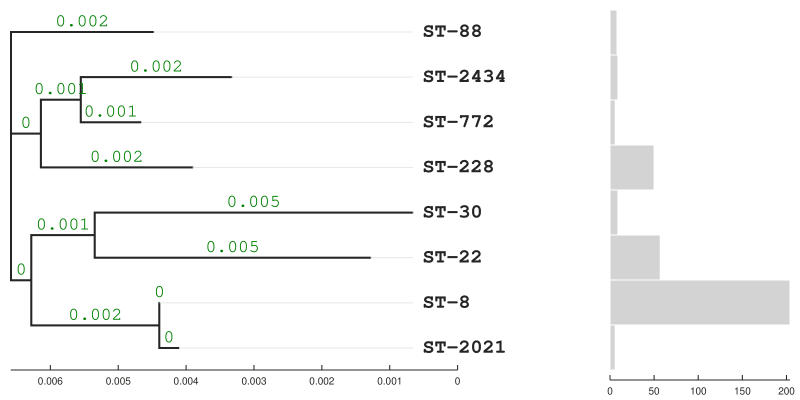

# MLST pipeline for *Staphylococcus aureus* (Snakemake)

Assignment for the course **Potoki obliczeniowe w bioinformatyce**

The pipeline takes genome assemblies of *S. aureus*, finds the 7 MLST genes in each
of them, assigns a sequence type (ST) to every genome and at the end draws
a neighbour-joining tree of the STs together with a bar plot showing how many
genomes belong to each ST.

## What is MLST

MLST (multi locus sequence typing) compares fragments of 7 housekeeping genes.
For *S. aureus* these are: `arcC`, `aroE`, `glpF`, `gmk`, `pta`, `tpi`, `yqiL`.
Every allele of a gene has a number and every combination of 7 allele numbers
has its own sequence type (ST). The allele numbers and STs come from the
[PubMLST](https://pubmlst.org) database.

## Steps of the pipeline

| Rule | What it does |
|---|---|
| `blastn` | searches every genome for every MLST gene (allele no. 1 is the query), one output file per gene:genome pair |
| `filter` | keeps only hits with 100% query coverage and alignment length equal to the query length |
| `merge_flt` | joins the filtered hits of all 7 genes, one file per genome |
| `mlst` | finds the allele numbers and the ST of a genome (ST is `-1` if the number of alleles is not 7 or an allele is not in the database) |
| `merge_mlst` | joins the MLST results of all genomes into one table |
| `unique` | writes one merged sequence per ST to a FASTA file (it works as an alignment) |
| `tree` | builds the NJ tree, saves it in the Newick format and draws `tree.png` |

```
queries + genomes -> blastn -> filter -> merge_flt -> mlst -> merge_mlst -> unique -> tree
```

## Repository structure

```
.
├── Snakefile              # the pipeline
├── config.yml             # settings (directory with genomes)
├── envs/                  # conda environments (.yml)
│   ├── powb-snake.yml     #   snakemake itself
│   ├── powb-blast.yml     #   BLAST+
│   └── powb-python.yml    #   python packages used by the scripts
├── scripts/               # python scripts used by the rules
│   ├── filter.py
│   ├── mlst.py
│   ├── unique.py
│   └── tree.py
├── input/
│   ├── queries/           # 7 query sequences (*.fna), one gene per file
│   ├── alleles.fna        # PubMLST allele sequences
│   └── bigsdb.tsv         # PubMLST table: allele numbers -> ST
├── genomes_test/          # optional: 10 test genomes (*.fna.gz)
├── results/               # final figure for the full data set
└── README.md
```

The directories `output/`, `log/` and `.snakemake/` are created by Snakemake and
are not kept in the repository (see `.gitignore`). The full genome assemblies
are not stored in Git. The seven small `input/queries/*.fna` files can be committed
for reproducibility; the reference files `input/alleles.fna` and `input/bigsdb.tsv`
are required inputs but are kept separately on Celsius and are not committed.
When running on another system, provide these reference files at the same paths.
Check whether `genomes_test/` is included before using the default test run.

## Requirements

- Linux
- conda (Miniforge)
- Snakemake (installed from `envs/powb-snake.yml`)

The other environments (`powb-blast`, `powb-python`) are created automatically
by Snakemake when the pipeline is run with `--sdm conda`.

## How to run

```bash
# 1. get the repository
git clone https://github.com/marysiat57-cloud/cautious-train.git
cd cautious-train

# 2. create and activate the environment with Snakemake
conda env create --file envs/powb-snake.yml
conda activate powb-snake

# 3. check what will be done (nothing is executed)
snakemake --dryrun --quiet rules

# 4. run on the test genomes (directory set in config.yml)
snakemake --cores 8 --sdm conda
```

To run on a different set of genomes change `genomesdir` in `config.yml`
or give it in the command line. The genome files must be named `<assembly ID>.fna.gz`.

```bash
# remove the results of the previous run first, because the merge rules
# collect all files that are in the output directories
rm -r output log

snakemake --cores 30 --sdm conda \
          --config genomesdir=/extra/Gordon_et_al_2017_raw_assemblies
```

## Output

| File | Content |
|---|---|
| `output/merge_mlst/merged.tsv` | table with `asmid`, `ST` and `mergedseq` for every genome |
| `output/unique.fna` | one merged sequence per ST |
| `output/tree.newick` | NJ tree in the Newick format |
| `output/tree.png` | the tree and the number of genomes per ST |

Log files of all rules are in `log/`.

## Results for the Gordon et al. 2017 genomes

The pipeline was run on 349 *Staphylococcus aureus* genome assemblies from
`/extra/Gordon_et_al_2017_raw_assemblies` (server Celsius).
All 349 genomes were assigned a sequence type (ST), with 8 distinct STs detected.



Number of genomes per ST was counted with:

```bash
tail -n +2 output/merge_mlst/merged.tsv | cut -f2 | sort -n | uniq -c
```

Comparison with Table 1 from the original publication
(Gordon et al. 2017, <https://doi.org/10.1128/jcm.00363-17>).
In the table every outbreak has one ST and a number of cases, so the cases
were summed up per ST.

| ST | Table 1 (cases) | This pipeline (genomes) |
|---|---:|---:|
| ST-8 | 204 | 204 |
| ST-22 | 58 | 57 |
| ST-30 | 35 | 9 |
| ST-59 | 3 | 0 |
| ST-88 | 8 | 8 |
| ST-121 | 5 | 0 |
| ST-228 | 50 | 50 |
| ST-239 | 7 | 0 |
| ST-772 | 6 | 6 |
| ST-2021 | 6 | 6 |
| ST-2434 | 9 | 9 |
| not assigned (`-1`) | – | 0 |
| **total** | **391** | **349** |

For six STs (ST-8, ST-88, ST-228, ST-772, ST-2021 and ST-2434), the numbers
match Table 1 exactly. The analyzed assembly set includes one fewer ST-22
and 26 fewer ST-30 genomes; ST-59, ST-121 and ST-239 are absent.
Together these differences account for 42 fewer genomes than cases reported
in Table 1. The two columns describe different sample sets (391 reported
cases versus 349 available assemblies), so the differences should not be
interpreted as MLST misclassifications without checking sample metadata.

## Authors

Maria Trzcińska ([@marysiat57-cloud](https://github.com/marysiat57-cloud))
Piotr Ślęzak
Piotr Michnal


## License

GPL-3.0 (see the `LICENSE` file).
